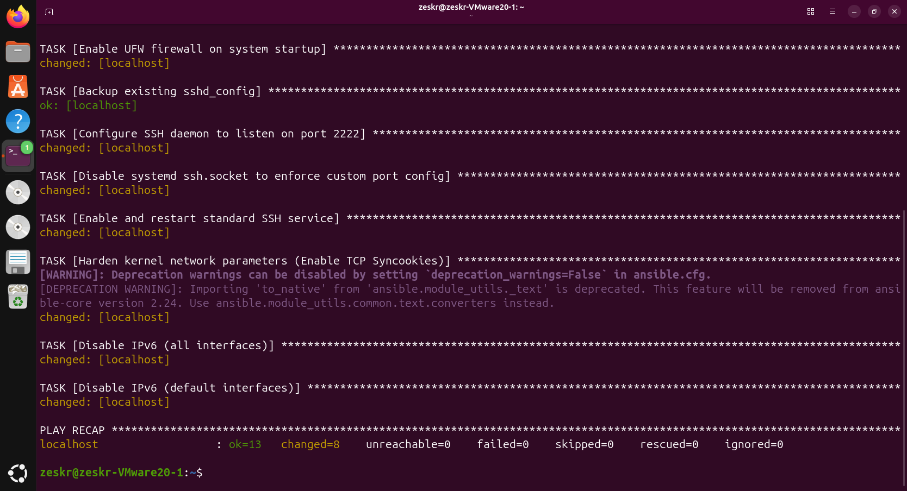
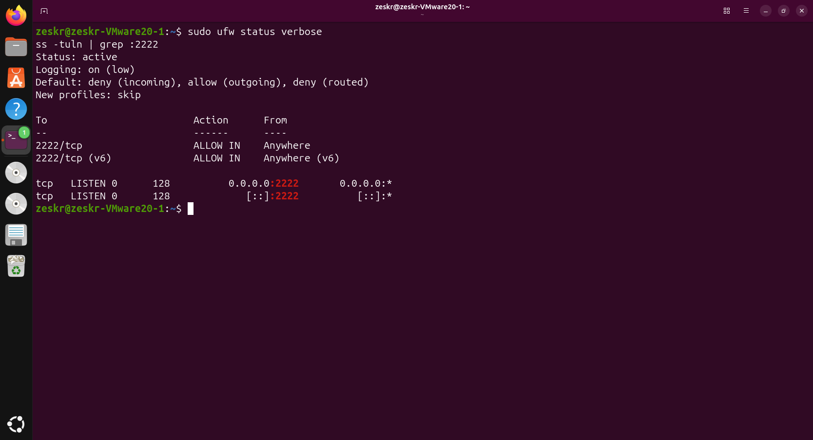

# ⚙️ Infrastructure as Code (IaC): Ansible Linux Hardening

## Overview
An enterprise-grade Ansible Playbook designed to programmatically deploy baseline security configurations across Ubuntu/Debian server fleets. By transitioning from sequential Bash scripting to declarative Infrastructure as Code (IaC), this deployment ensures idempotency, minimizes configuration drift, and scales securely to thousands of nodes simultaneously.

## Technical Skills Applied
* **Infrastructure as Code (IaC):** Writing idempotent YAML playbooks utilizing native Ansible modules (`apt`, `ufw`, `sysctl`, `systemd`, `lineinfile`).
* **Fleet Management & Automation:** Orchestrating automated configuration changes without requiring manual SSH interaction.
* **Kernel & Network Hardening:** Enforcing strict UFW default-deny policies and mitigating volumetric attacks (SYN floods) via declarative kernel parameter tuning.
* **Service Orchestration:** Circumventing default OS routing (disabling `systemd` socket activation) to enforce custom SSH daemon port configurations.

## Installation & Usage

**Prerequisites:** Ansible installed on the control node.

```bash
# Clone the repository
git clone [https://github.com/Zeskr/Ansible-Linux-Hardening.git](https://github.com/Zeskr/Ansible-Linux-Hardening.git)
cd Ansible-Linux-Hardening

# Execute the playbook against a target inventory
ansible-playbook -i inventory.ini hardening.yaml -K
```

---

## Technical Execution & Proof of Concept

### Phase 1: Declarative Execution
Running the playbook initiates a series of automated tasks. Ansible's idempotent nature ensures that if a server is already hardened, no redundant changes are made, preventing service disruption.



### Phase 2: Post-Deployment Verification
Following the automated deployment, manual verification confirms the firewall is actively dropping unapproved traffic, TCP Syncookies are enabled in live memory, and the SSH daemon has successfully migrated off default port 22.


